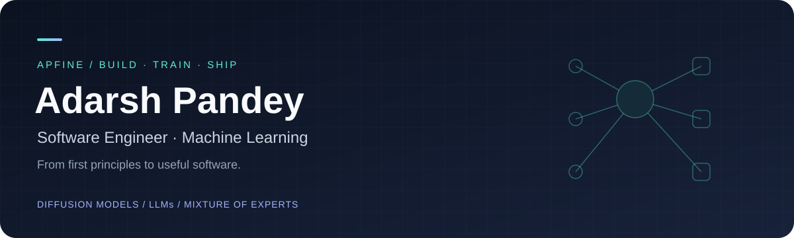

  

# Adarsh Pandey

### Software Engineer · Machine Learning · Full-Stack Development

Building generative models from first principles and turning ideas into useful software.

[Portfolio](https://apworks.vercel.app) &nbsp; / &nbsp; [LinkedIn](https://linkedin.com/in/aphere) &nbsp; / &nbsp; [Email](mailto:aphere@outlook.in)

  
  
  
  

---

## About me

I'm a software engineer developing in machine learning, with hands-on experience training diffusion models and understanding how generative models work from scratch. My interests span **diffusion models, large language models, and mixture of experts**, from their underlying mathematics and architectures to training and inference.

Alongside ML, I build full-stack applications, backend services, and interactive interfaces. I care about clear architecture, reliable software, and the engineering that takes an experiment into a usable product.

## Machine learning, from first principles

| Area | Focus |
| :--- | :--- |
| **Diffusion models** | Hands-on model training; understanding forward noising, learned denoising, training objectives, and sampling from scratch. |
| **LLMs** | Understanding language models from scratch: tokenization, embeddings, attention, transformer blocks, autoregressive training, and inference. |
| **Mixture of experts** | Understanding MoE from scratch: expert networks, routing, sparse activation, and load balancing. |
| **Applied ML** | NLP and semantic search, computer vision and CNNs, predictive modeling, inference APIs, and model deployment. |

## Selected work

Four featured projects from [my portfolio](https://apworks.vercel.app).

<table>
<tr>
<td width="50%" valign="top">
<h3>01 / DUNES</h3>

<strong>Starbase Mars Simulator</strong>

A browser-based Mars driving and orbital flight simulator with procedural terrain, 0.38G physics, telemetry, atmospheric rendering, and a Starship launch sequence.

Three.js · WebGL · Next.js · GLSL

<a href="https://playmars.vercel.app/">Explore DUNES ↗</a>

</td>
<td width="50%" valign="top">
<h3>02 / CARRYEM</h3>

<strong>AI Career Platform</strong>

AI-powered resume generation, semantic job search, and candidate-to-role matching using NLP embeddings and sentence transformers.

Next.js · FastAPI · Python · spaCy · Sentence-Transformers

<a href="https://carryem.vercel.app/">Explore CARRYEM ↗</a>

</td>
</tr>
<tr>
<td width="50%" valign="top">
<h3>03 / Astro Alliance</h3>

<strong>NIT Bhopal Astronomy Society</strong>

The society's official web platform, with celestial event schedules, interactive galleries, responsive member workflows, and animated interfaces.

Next.js · React · Tailwind CSS · Framer Motion

<a href="https://astroalliancenitb.in">Visit Astro Alliance ↗</a>

</td>
<td width="50%" valign="top">
<h3>04 / Flexible Bento Grid</h3>

<strong>Responsive Interface Design</strong>

A flexible Bento-style layout exploring responsive composition, CSS, and micro-interactions for portfolio and product interfaces.

Next.js · React · TypeScript · Tailwind CSS

<a href="https://bentogrid1.vercel.app/">Explore the layout ↗</a> · <a href="https://github.com/apfine/BentoGrid">Source</a>

</td>
</tr>
</table>

**More software & ML work:** [FOODIE](https://foodie60.vercel.app) — CNN-based crop disease classification served through a REST API; [SAKH](https://sakhcredit.vercel.app) — credit risk prediction with XGBoost and FastAPI. I also work on reusable C++ utilities and algorithms through **cpplib**.

## Open source

Selected pull requests across ML tooling, agent systems, and developer experience. Statuses reflect the latest check; each link shows the current discussion.

| Project | Contribution | Status |
| :--- | :--- | :--- |
| **Google Gemini CLI** | [Antigravity CLI discovery fallbacks across operating systems #22030](https://github.com/google-gemini/gemini-cli/pull/22030) | Merged |
| **Mesa LLM** | [Warnings when loading and saving pickle-based recordings #181](https://github.com/mesa/mesa-llm/pull/181) | Merged |
| **Mesa LLM** | [Pydantic-validated structured LLM decisions #188](https://github.com/mesa/mesa-llm/pull/188) | Open |
| **Mesa LLM** | [JSONL streaming to bound recorder memory growth #183](https://github.com/mesa/mesa-llm/pull/183) | Open |
| **Google Gemini CLI** | [tmux-safe thinking indicator #22067](https://github.com/google-gemini/gemini-cli/pull/22067) | Closed, unmerged |
| **OpenAI-CLIP implementation** | [Dataset description correction #26](https://github.com/moein-shariatnia/OpenAI-CLIP/pull/26) | Open |

[All public pull requests →](https://github.com/pulls?q=is%3Apr+author%3Aapfine+archived%3Afalse)

## Engineering toolkit

| Layer | Technologies & interests |
| :--- | :--- |
| **ML & data** | Python · PyTorch · TensorFlow · Keras · NumPy · Pandas · scikit-learn · XGBoost |
| **Generative AI & vision** | Diffusion models · Transformers · LLMs · MoE · NLP · CNNs · OpenCV · YOLO |
| **Backend & systems** | FastAPI · Flask · Node.js · Express · REST APIs · C++ · Algorithms · System architecture |
| **Frontend & product** | React · Next.js · TypeScript · JavaScript · Tailwind CSS · Framer Motion · UI/UX · Design systems |
| **Delivery & storage** | Git · Docker · AWS · Vercel · PostgreSQL · MongoDB · MLOps · Inference pipelines |

## Current focus

- Deepening model understanding through diffusion, transformer, and MoE implementations from scratch.
- Connecting model training and evaluation with practical inference and deployment.
- Shipping AI applications with reliable APIs and thoughtful interfaces.
- Contributing to open source ML infrastructure and developer tools.

<strong>GitHub activity</strong>

 

  
  

  

---

  <strong>Build useful things. Design with intent. Ship with depth.</strong>  
  <a href="https://apworks.vercel.app">Portfolio</a> &nbsp;·&nbsp;
  <a href="https://linkedin.com/in/aphere">LinkedIn</a> &nbsp;·&nbsp;
  <a href="mailto:aphere@outlook.in">Let's connect</a>

